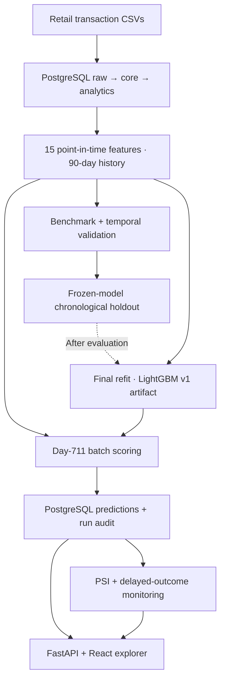

# Retail Customer Analytics

[](https://github.com/dorsakh/retail-customer-analytics/actions/workflows/python-tests.yml)
[](https://github.com/dorsakh/retail-customer-analytics/actions/workflows/frontend-tests.yml)

**An end-to-end customer repurchase prediction system:** PostgreSQL data modeling, temporally evaluated LightGBM, versioned batch inference, drift monitoring, and a React customer explorer. Built on the [dunnhumby *The Complete Journey*](https://www.dunnhumby.com/source-files/) retail dataset.

**Python · SQL · PostgreSQL · LightGBM · scikit-learn · FastAPI · React · TypeScript · Vite · Recharts · Docker Compose · pytest · Vitest · GitHub Actions**

**[Watch the 58-second application walkthrough](docs/assets/retail_demo.mp4)** · [Local setup](docs/SETUP.md)


## Results at a glance

| Historical evaluation | Result |
|---|---:|
| Transaction lines / baskets / source households | **2.60M / 276,484 / 2,500** |
| Labeled observations / modeled households | **41,507 / 2,493** |
| Chronological holdout | **6,977 observations** across 3 future dates |
| LightGBM ROC-AUC / average precision | **0.809 / 0.858** |
| Holdout Brier score | **0.176** |
| Precision@20% / lift | **94.1% / 1.64×** |
| Gain over recency–frequency ranking at the same capacity | **+13.9 percentage points** (95% household-bootstrap CI: +11.8 to +15.9 pp) |
| Latest production-style batch | **2,326 households** scored at observation day 711 |

At 20% selection capacity, the model ranked **194 more observed future-purchase instances** in its shortlist than the recency/frequency baseline (1,397 selected observations in either strategy). This measures **ranking quality**, not incremental conversions or revenue caused by targeting.


## System overview



| Component | Engineering implementation |
|---|---|
| **Data platform** | Three PostgreSQL layers; referential, row-count, and monetary reconciliation; parameterized point-in-time feature marts; 15 behavioral inputs |
| **Modeling** | Five-model benchmark, rolling-origin validation, fixed chronological holdout, probability diagnostics, feature importance, household-cluster bootstrap |
| **Inference** | Native LightGBM `v1` artifact (~0.5 MB); exact feature-schema and SHA-256 checks; ranked probabilities and deciles stored through idempotent PostgreSQL upserts |
| **Automation** | Batch validation, per-day PostgreSQL advisory locks, audited `running/succeeded/failed/skipped` states; optional 24-hour Docker Compose scheduler |
| **Monitoring** | Feature/prediction population stability index (PSI), missingness alerts, delayed seven-day outcome evaluation, persisted operational reports |
| **Delivery** | FastAPI/Pydantic/OpenAPI, React 19/TypeScript/Recharts, Docker image with non-root API container, automated Python and frontend CI |

## Behind the Basket — customer explorer

The React interface queries real PostgreSQL prediction and profile tables; the day-711 directory contains **all 2,326 scored households**, not a synthetic sample.

- **Customer Explorer:** server-side search, sorting, and pagination; profile drawer with purchase timeline, 15 features, five cohort-relative shopping metrics, and live model inference.
- **Behavioral Paradox:** compare households with similar recency and shopping frequency but different scores; inspect their feature differences and native LightGBM contributions without leaving the comparison.
- **Beat the Model:** predict seven-day repurchase on historical holdout cases, then reveal the outcome and compare Brier losses against the holdout model.
- **Model Pulse:** review persisted PSI/missingness reports and audited batch-execution history.

The shared contextual customer drawer keeps the original view and selection visible. The compiled React app is served by FastAPI; Vite proxies the same API in development.


The screenshots and [one-minute walkthrough](docs/assets/retail_demo.mp4) were captured from the locally running application with the real-data PostgreSQL backend. This is a recorded demo, **not a publicly hosted service**.

## Evaluation protocol

| Partition | Observation days | Rows |
|---|---|---:|
| Training | 180–540, at 30-day intervals | 29,902 |
| Validation | 570, 600 | 4,628 |
| **Unseen chronological holdout** | **630, 660, 690** | **6,977** |

Every observation uses **15 features from the previous 90 days** to predict **any purchase in the following seven days**. The holdout estimator was fitted only through day 600. The saved `v1` scoring model was subsequently refitted on all 41,507 labeled observations; **its training-window predictions are not used as holdout metrics**. Whole-household bootstrap resampling accounts for repeated snapshots of the same household. See [technical notes](docs/ENGINEERING.md) for model comparisons, calibration, capacity curves, uncertainty, and limitations.

## Run locally

The repository contains code, SQL definitions, tests, and the versioned model artifact; **the original transaction CSVs and PostgreSQL database are not included**. Reproducing the real-data explorer requires loading the source dataset, creating the analytical tables, and materializing explorer profiles first. Follow the [setup and runbook](docs/SETUP.md) for the full sequence.

```bash
# Install modeling, serving, and test dependencies
python -m pip install -e ".[modeling,serving,dev,reporting]"

# Once the real-data database and model artifact are configured
python -m retail_analytics.pipeline --dry-run
python -m retail_analytics.pipeline
python -m retail_analytics.monitor --as-of-day 711

# Verify the Python code
python -m pytest -q

# Build and test the React UI
npm --prefix frontend ci
npm --prefix frontend test
npm --prefix frontend run build
```

After preparing the PostgreSQL service as documented, the API and opt-in daily scheduler can run locally with `docker compose --profile automation up -d --build`. The React explorer is served on `http://127.0.0.1:8000/` in that Docker configuration.

## Repository structure

```text
sql/{schema,load,marts,checks,analysis}/   PostgreSQL ELT, point-in-time features, validation
src/retail_analytics/                    Training, evaluation, inference, monitoring, API
frontend/src/{pages,components}/          React + TypeScript explorer
tests/                                    Python unit and API tests
docs/                                     Reproduction runbook and engineering notes
reports/{tables,figures}/                 Selected aggregate results and visualizations
artifacts/models/v1/                      Native model and integrity metadata
.github/workflows/                       Python and React test/build CI
Dockerfile, compose.yaml                  Local PostgreSQL/API/scheduler containers
```

**Verification:** 46 Python tests and 4 React UI tests at the documented release, plus type-checked frontend builds and GitHub Actions CI. Batch scoring is repeatable/idempotent; the day-711 monitoring outcome status is `pending` because the source dataset ends before that prediction window matures.

**Scope:** Local Docker deployment and CI are implemented; public cloud hosting, automatic CD, MLflow tracking, and causal marketing-uplift measurement are **not** claimed. Results describe future purchase propensity for historically observed households, not cold-start generalization.
