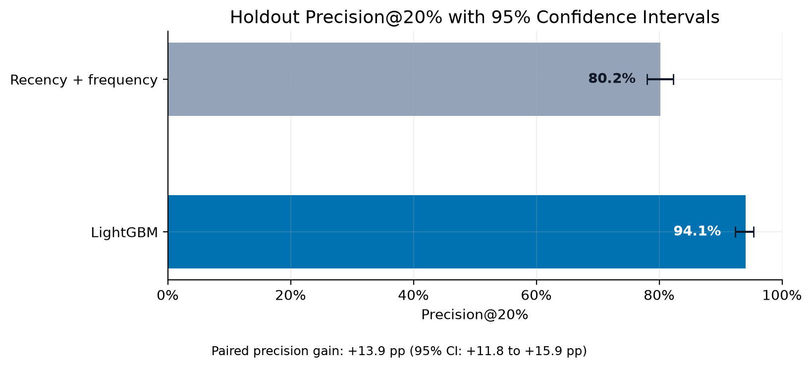
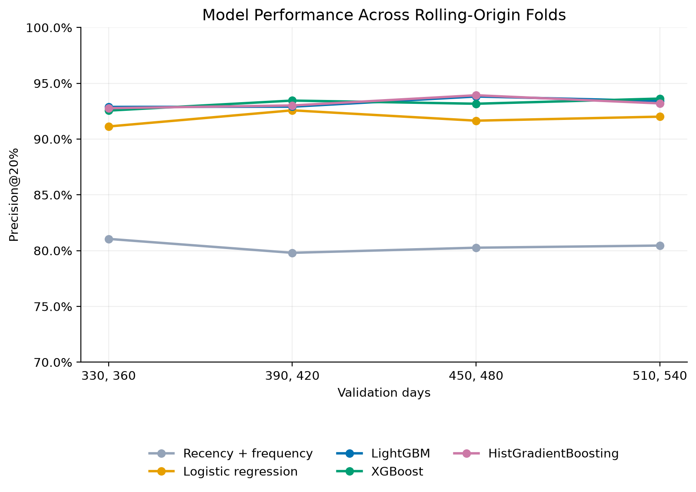
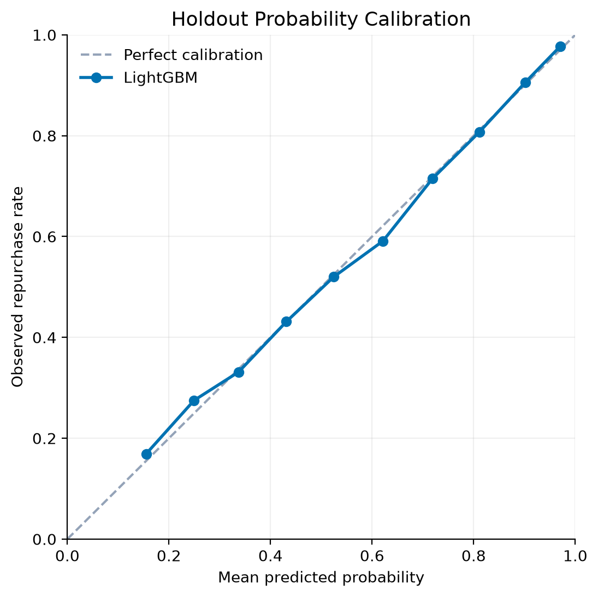
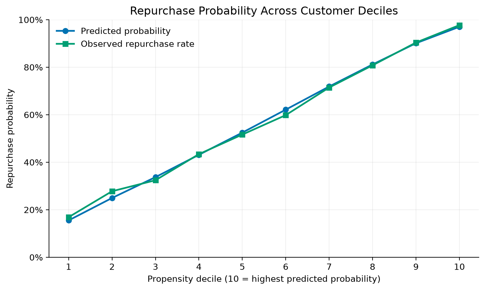
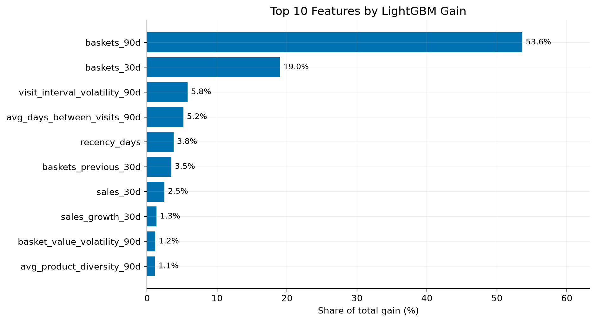

# Retail Customer Analytics

An end-to-end retail analytics and machine learning project built with PostgreSQL and Python, using dunnhumby's *The Complete Journey* dataset.

The project transforms transaction-level retail data into a relational analytics model, examines household purchasing behavior, and predicts whether an existing customer will make another purchase within the next seven days.

The workflow includes SQL-based data engineering, historical feature generation, time-aware model validation, model benchmarking, probability calibration, uncertainty estimation, and customer propensity analysis.

## Key Results

On the final time-based holdout set, the selected LightGBM model achieved:

| Metric | Result |
|---|---:|
| ROC AUC | 0.809 |
| Average precision | 0.858 |
| Brier score | 0.176 |
| Precision@20% | **94.1%** |
| Lift@20% | **1.643×** |

A recency-and-frequency ranking baseline achieved 80.2% Precision@20%.

LightGBM improved Precision@20% by **13.9 percentage points**, with a 95% household-cluster bootstrap confidence interval of **11.8 to 15.9 percentage points**.



Precision@20% measures the proportion of households that repurchase within seven days among the highest-ranked 20% of households at each observation date.

These results demonstrate improved predictive ranking, not the causal effect of any marketing intervention.

## Dataset

The project uses [dunnhumby's The Complete Journey](https://www.dunnhumby.com/source-files/), a retail dataset containing approximately two years of purchasing activity from 2,500 frequent-shopping households.

### Data Overview

| Dataset component | Records |
|---|---:|
| Transaction line items | 2,595,732 |
| Unique shopping baskets | 276,484 |
| Households | 2,500 |
| Products | 92,353 |
| Marketing campaigns | 30 |
| Coupon redemption events | 2,318 |

Transaction dates are represented as sequential day numbers from 1 to 711.

Seven source tables are used:

- Transactions
- Products
- Household demographics
- Campaign definitions
- Campaign assignments
- Coupon definitions
- Coupon redemptions

The original CSV files are not included in this repository.

They can be obtained from [dunnhumby](https://www.dunnhumby.com/source-files/) or the [Kaggle dataset](https://www.kaggle.com/datasets/frtgnn/dunnhumby-the-complete-journey).

## Data Architecture

The data pipeline follows an ELT architecture implemented in PostgreSQL.

### Raw Layer

Original CSV records are loaded into the `raw` schema.

Initial validation checks examine:

- Source row counts
- Missing and duplicate identifiers
- Candidate keys
- Basket consistency
- Relationships between source tables

### Core Layer

Raw records are transformed into typed relational tables within the `core` schema.

The core layer standardizes transactions, households, products, campaigns, and coupons.

Repeated coupon-to-product mappings are deduplicated to prevent row multiplication in downstream joins while preserving the original raw records.

Reconciliation checks verify that transaction counts, basket counts, quantities, sales, and discount totals remain consistent between the raw and core layers.

### Analytics Layer

The `analytics` schema contains analytical datasets derived from the core tables.

These include:

- Basket-level and household purchasing summaries
- Customer behavior metrics
- Historical household snapshots
- Seven-day repeat-purchase outcomes
- Supporting views for analytical reporting

Historical household snapshots provide the features used by the predictive models.

## SQL Analytics

In addition to predictive modeling, the project includes three analytical components.

### Customer Purchasing Behavior

Examines purchasing frequency, recency, spending patterns, and repeat-purchase behavior.

### Cohort Retention

Groups households by their first observed purchase period and measures subsequent purchasing activity in 30-day intervals.

Retention calculations account for incomplete observation windows, and small cohorts are excluded from the main reporting view.

Because the dataset consists of frequent shoppers, a first-observed purchase is not necessarily a customer's first-ever purchase.

### Campaign Performance

Analyzes campaign targeting, coupon redemption participation, purchasing activity, and spending during promotional periods.

Campaign-period spending is compared with an equally long preceding period when both windows are fully observed.

These comparisons are descriptive and should not be interpreted as causal estimates of campaign effectiveness.

## Machine Learning Problem

### Prediction Target

The objective is to estimate the probability that a household will make at least one purchase within the seven days following a historical observation date.

Each modeling observation represents one household at one point in time:

`(household_key, as_of_day)`

The binary target is:

- `1`: The household makes a purchase within the following seven days.
- `0`: No purchase occurs within that prediction window.

### Feature Engineering

Fifteen behavioral predictors are calculated in SQL using information available at each observation date.

Feature groups include:

| Category | Examples |
|---|---|
| Recency | Days since the most recent purchase |
| Purchase frequency | Basket counts over 30 and 90 days |
| Spending | Recent sales, historical sales, and spending growth |
| Basket behavior | Average basket value and basket-value volatility |
| Product behavior | Average product diversity |
| Shopping patterns | Number of distinct stores |
| Promotion sensitivity | Discount share |
| Visit regularity | Average time between visits and visit-interval volatility |

The features use historical purchasing windows, including trailing 90-day activity.

Missing values are retained when a feature cannot be meaningfully calculated from the available purchasing history. Model-specific preprocessing handles these values.

### Modeling Dataset

| Dataset characteristic | Value |
|---|---:|
| Household snapshots | 41,507 |
| Unique households | 2,493 |
| Predictive features | 15 |
| Prediction horizon | 7 days |

Snapshots are evaluated at 30-day intervals.

SQL data-quality checks verify the validity of visit intervals, interval volatility, recency, and basket counts.

## Temporal Validation

The dataset is divided chronologically to evaluate predictions on later observation dates.

| Split | Observation days | Observations |
|---|---|---:|
| Training | 180–540, every 30 days | 29,902 |
| Validation | 570, 600 | 4,628 |
| Holdout test | 630, 660, 690 | 6,977 |

The training and validation periods are used for development and model comparison.

The final holdout period is reserved for evaluating the selected model.

### Leakage Prevention

Several design choices reduce the risk of temporal data leakage:

- Predictors are constructed from historical activity available at each observation date.
- The seven-day outcome is defined after the observation date.
- Observation dates are spaced 30 days apart, preventing overlap between seven-day prediction windows.
- Training and validation splits follow chronological order.
- The final holdout period is excluded from model benchmarking and selection.

The same households may appear at different observation dates.

Consequently, this evaluation measures generalization to future periods for existing customers, rather than generalization to entirely unseen households.

## Model Benchmarking

The following approaches are compared:

1. Recency-and-frequency ranking baseline
2. Logistic regression
3. LightGBM
4. XGBoost
5. HistGradientBoosting

Logistic regression uses median imputation, missing-value indicators, and feature standardization.

The gradient-boosting models are configured with regularization and controlled model complexity.

### Validation Performance

| Model | ROC AUC | Average Precision | Brier | Precision@20% |
|---|---:|---:|---:|---:|
| Recency + frequency | — | — | — | 0.813 |
| Logistic regression | 0.813 | 0.860 | 0.174 | 0.937 |
| LightGBM | **0.818** | **0.866** | **0.172** | 0.948 |
| XGBoost | 0.817 | 0.865 | 0.172 | **0.950** |
| HistGradientBoosting | **0.818** | **0.866** | **0.172** | 0.946 |

The ranking-only baseline is evaluated using Precision@20% and lift. Probability-based metrics are not reported because it does not produce calibrated probability estimates.

### Rolling-Origin Evaluation

Four additional rolling-origin folds assess model behavior across earlier historical periods.

Each fold trains models using observations available before its validation period.

The average Precision@20% across the four folds is:

| Model | Mean Precision@20% |
|---|---:|
| LightGBM | **0.933** |
| XGBoost | 0.932 |
| HistGradientBoosting | 0.932 |
| Logistic regression | 0.918 |
| Recency + frequency | 0.804 |



### Model Selection

LightGBM is selected as the final model based on its competitive validation performance, consistency across rolling-origin folds, and strong probability-based metrics.

The differences among the gradient-boosting approaches are small. These benchmark results do not establish that LightGBM is universally superior to the other models.

The selected configuration is defined in `src/retail_analytics/models.py`.

## Final Holdout Evaluation

After model selection, LightGBM is fitted on the combined training and validation observations.

The resulting model is evaluated on the chronologically later holdout set.

| Metric | Recency + Frequency | LightGBM |
|---|---:|---:|
| ROC AUC | — | 0.809 |
| Average precision | — | 0.858 |
| Brier score | — | 0.176 |
| Precision@20% | 0.802 | **0.941** |
| Lift@20% | 1.401 | **1.643** |

The holdout set contains 6,977 observations and has an overall seven-day repurchase rate of 57.23%.

### Performance Across Holdout Dates

| Observation day | Baseline Precision@20% | LightGBM Precision@20% |
|---|---:|---:|
| 630 | 0.818 | 0.938 |
| 660 | 0.815 | 0.951 |
| 690 | 0.772 | 0.933 |

The model maintains higher Precision@20% than the baseline across all three holdout dates.

### Uncertainty Estimation

A household-cluster bootstrap is used to estimate confidence intervals for Precision@20% and the paired improvement over the baseline.

Sampling at the household level accounts for repeated observations from the same household.

| Quantity | Estimate | 95% Confidence Interval |
|---|---:|---:|
| Baseline Precision@20% | 0.802 | [0.780, 0.823] |
| LightGBM Precision@20% | 0.941 | [0.924, 0.954] |
| Paired precision improvement | +0.139 | [+0.118, +0.159] |

These intervals describe sampling uncertainty for the evaluated holdout observations with the fitted model held fixed. They do not account for model-training uncertainty or future temporal distribution shifts.

## Probability Calibration

Predicted probabilities are compared with observed seven-day repurchase rates using quantile-based probability bins.



The calibration results indicate that predicted probabilities are generally close to observed event frequencies across the holdout distribution.

## Customer Propensity Segmentation

Households are ranked by predicted repurchase probability separately at each observation date and assigned to ten propensity groups.

Decile 10 contains households with the highest predicted probabilities, while decile 1 contains those with the lowest.



The observed seven-day repurchase rate increases from approximately 16.9% in the lowest propensity decile to 97.7% in the highest.

The decile summaries also include historical purchase frequency and recency, supporting interpretation of the customer groups.

These segments describe purchase propensity; they do not measure the incremental impact of contacting or incentivizing customers.

## Feature Importance

LightGBM gain-based feature importance is used to describe the model's reliance on individual predictors.

The most influential variables are historical basket frequency measures, followed by visit-regularity and recency features.



Gain-based importance is a model-specific descriptive measure. It does not establish causal relationships, and importance may be distributed across correlated predictors.

## Repository Structure

```text
.
├── data/
│   └── raw/                     # Source files (excluded from Git)
│
├── scripts/                     # Data download and target assessment
│
├── sql/
│   ├── schema/                  # Raw and core schema definitions
│   ├── load/                    # Data loading and core transformations
│   ├── checks/                  # Integrity and reconciliation checks
│   ├── marts/                   # Analytical tables and household snapshots
│   └── analysis/                # Customer, cohort, and campaign analyses
│
├── src/
│   └── retail_analytics/
│       ├── data.py              # Database loading and temporal splits
│       ├── models.py            # Model configurations
│       ├── metrics.py           # Evaluation and ranking metrics
│       ├── train.py             # Validation and calibration
│       ├── benchmark.py         # Model comparisons and rolling-origin folds
│       ├── evaluate.py          # Final holdout evaluation
│       ├── uncertainty.py       # Household-cluster bootstrap
│       └── visualize.py         # Result visualization
│
├── tests/                       # Automated tests
│
├── reports/
│   ├── tables/                  # Evaluation results as CSV files
│   └── figures/                 # Generated PNG visualizations
│
├── pyproject.toml               # Python project configuration
└── README.md
```

## Getting Started

### Requirements

- Python 3.11 or newer
- PostgreSQL and the `psql` command-line client
- The Complete Journey CSV files

The SQL implementation has been tested with PostgreSQL 18.

### 1. Install Python Dependencies

From the repository root:

```bash
python -m pip install -e ".[modeling,dev,reporting]"
```

This installs the project in editable mode together with its modeling, testing, and visualization dependencies.

### 2. Prepare the Source Data

Download the dataset and place these CSV files in:

`data/raw/complete_journey/`

```text
campaign_desc.csv
campaign_table.csv
coupon.csv
coupon_redempt.csv
hh_demographic.csv
product.csv
transaction_data.csv
```

The raw dataset directory is excluded from Git.

### 3. Create the PostgreSQL Database

```bash
createdb retail_analytics
```

The default Python database connection is:

```text
postgresql+psycopg:///retail_analytics
```

A different connection can be configured using the `RETAIL_DATABASE_URL` environment variable.

### 4. Load and Validate the Data

Create and populate the raw schema:

```bash
psql -d retail_analytics -v ON_ERROR_STOP=1 -f sql/schema/raw.sql

psql -d retail_analytics -v ON_ERROR_STOP=1 -1 -f sql/load/load_raw.sql

psql -d retail_analytics -v ON_ERROR_STOP=1 -f sql/checks/raw_row_counts.sql

psql -d retail_analytics -v ON_ERROR_STOP=1 -f sql/checks/raw_integrity.sql
```

Create and populate the core schema:

```bash
psql -d retail_analytics -v ON_ERROR_STOP=1 -f sql/schema/core.sql

psql -d retail_analytics -v ON_ERROR_STOP=1 -1 -f sql/load/load_core.sql

psql -d retail_analytics -v ON_ERROR_STOP=1 -f sql/checks/core_reconciliation.sql
```

Build the analytical datasets:

```bash
psql -d retail_analytics -v ON_ERROR_STOP=1 -f sql/marts/customer_behavior.sql

psql -d retail_analytics -v ON_ERROR_STOP=1 -f sql/marts/household_snapshots.sql
```

These commands describe a fresh database setup. The loading scripts are not intended for repeatedly appending the same source records.

### 5. Run the SQL Analyses

```bash
psql -d retail_analytics -f sql/analysis/repurchase_signals.sql

psql -d retail_analytics -f sql/analysis/cohort_retention.sql

psql -d retail_analytics -f sql/analysis/campaign_performance.sql
```

### 6. Run the Machine Learning Pipeline

Inspect the modeling dataset and chronological splits:

```bash
python -m retail_analytics.data
```

Run training and validation:

```bash
python -m retail_analytics.train
```

Run the model benchmark:

```bash
python -m retail_analytics.benchmark
```

Evaluate the selected model on the holdout set:

```bash
python -m retail_analytics.evaluate
```

Generate the figures from saved evaluation results:

```bash
python -m retail_analytics.visualize
```

### 7. Run the Tests

```bash
python -m pytest -q
```

The test suite covers temporal split boundaries, non-overlapping prediction windows, ranking metrics, edge cases, and bootstrap calculations.

## Generated Outputs

The benchmark and holdout evaluation scripts save their aggregate results in:

`reports/tables/`

The visualization script reads these tables and generates figures in:

`reports/figures/`

The visualization step does not retrain the machine learning models.

## Scope and Limitations

- The dataset primarily represents frequent-shopping households and may not reflect the broader retail customer population.
- The evaluation measures performance on future observation dates for known households, not entirely unseen households.
- Historical spending and campaign comparisons are observational and do not establish causal effects.
- High repurchase propensity does not necessarily identify customers who would benefit most from a marketing intervention.
- Performance estimates are specific to this dataset, prediction horizon, and evaluation design.
- Bootstrap confidence intervals do not account for all possible sources of uncertainty, including temporal distribution shifts.

## Technologies

**Data engineering:** PostgreSQL, SQL, SQLAlchemy, psycopg

**Data analysis:** Python, pandas, NumPy

**Machine learning:** scikit-learn, LightGBM, XGBoost

**Evaluation:** Time-based validation, rolling-origin evaluation, ROC AUC, average precision, Brier score, Precision@20%, lift, household-cluster bootstrap

**Visualization:** Matplotlib

**Testing and packaging:** pytest, setuptools, TOML