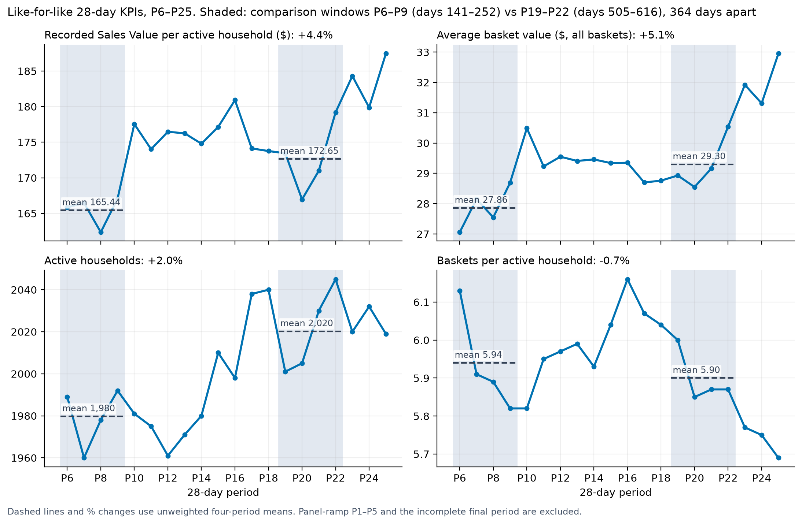
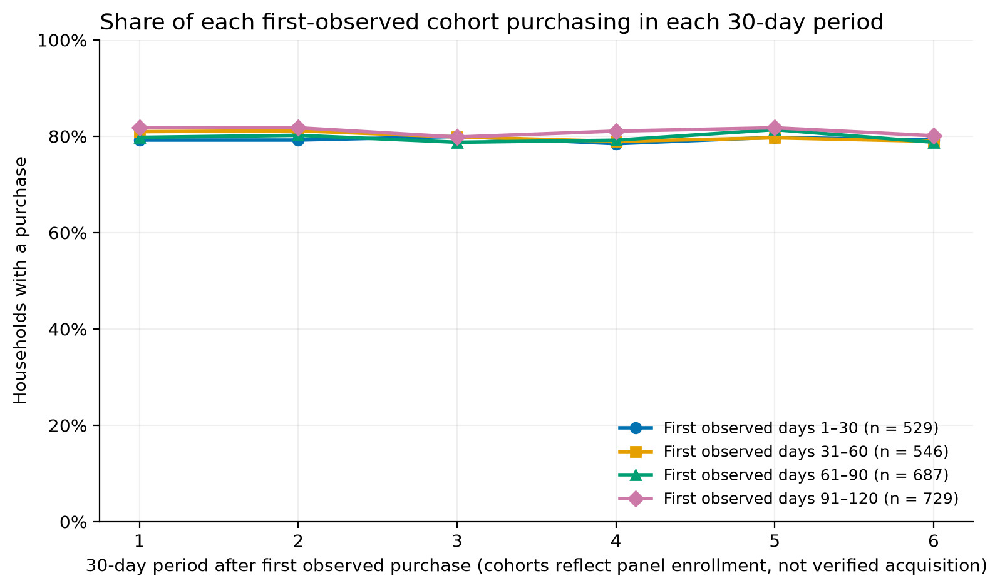
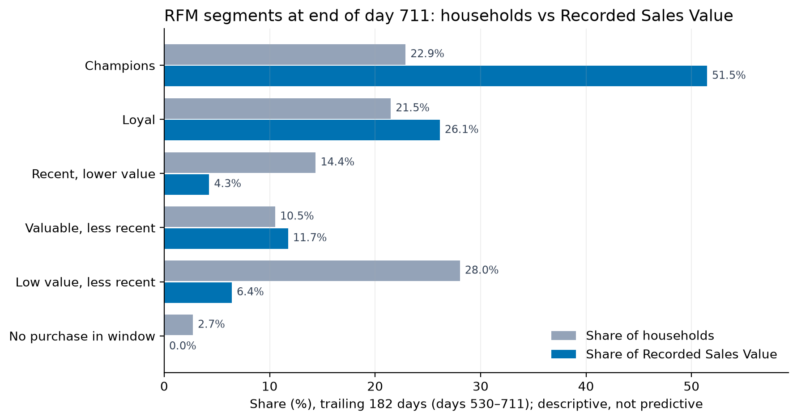

# Behind the Basket: Retail Retention Analytics

**Problem:** Which repeat shoppers are likely to make **no purchase in the next 14 days**?

**Decision:** Rank customers for retention review while keeping **all 2,500 known households** visible—including those too inactive to score reliably.

**Result:** On a chronological holdout, Logistic Regression reached **45.5% Precision@20%**, **2.38× lift**, and **0.802 ROC-AUC**. A strong frequency-only rule reached **43.9%**; the **+1.55-pp** difference was inconclusive under household bootstrap. This predicts a *short-term lapse*, **not permanent churn, coupon response, or incremental revenue**.

**Descriptive analytics:** PostgreSQL SQL over the same data produces reconciled 28-day business KPIs, first-observed cohort retention, and RFM customer segmentation. See [Descriptive business analytics](#descriptive-business-analytics).

[](https://github.com/dorsakh/retail-customer-analytics/actions/workflows/python-tests.yml)
[](https://github.com/dorsakh/retail-customer-analytics/actions/workflows/frontend-tests.yml)

**Python · SQL · PostgreSQL · scikit-learn · LightGBM · FastAPI · React · TypeScript · Recharts · Docker · pytest · Vitest · GitHub Actions**

[**Watch the 55-second application walkthrough**](docs/assets/behind_the_basket_demo.mp4) · [Architecture](#architecture) · [Reproduce locally](#run-and-verify) · [Retention methodology](docs/RETENTION.md) · [Engineering notes](docs/ENGINEERING.md)

[](docs/assets/behind_the_basket_demo.mp4)

*Local application with the original dunnhumby data. Click the screenshot for the 55-second MP4 walkthrough; this is not a publicly hosted web app.*

## Business decision and coverage

The **Retention Lab** presents a risk-ranked shortlist, individual customer inspection, historical model evidence, and explicitly hypothetical campaign economics.

| Day-711 segment | Households | Treatment |
|---|---:|---|
| Active | 1,543 | Scored; below the top-risk cutoff |
| **At risk** | **386** | **Top 20% predicted lapse risk among eligible households** |
| Inactive / dormant | 280 / 174 | Visible; separate lifecycle rules |
| Limited history | 117 | Visible; insufficient evidence to score |
| **Total** | **2,500** | **1,929 model-scored + 571 unscored** |

A high lapse score helps choose **whom to investigate or include in a controlled campaign test**. It does not establish that an offer will change their behavior.

**What lapse means:** Among **5,944 eligible household-date observations** labeled as 14-day lapses (**1,826 distinct households**), **76.6%** made another purchase within 30 days *after the lapse window* and **89.2%** within 60 days. Each observation has a complete 60-day follow-up after day 14, avoiding right-censoring. The model identifies temporary disengagement, not confirmed customer loss.

## Historical evaluation

Features are computed *as of each prediction date* from past transactions. The untouched holdout spans **days 600/630/660**, containing **5,808 household-date observations** from **2,163 distinct households**.

| Holdout model | ROC-AUC | Precision@20% | Lift@20% |
|---|---:|---:|---:|
| Recency baseline | 0.676 | 37.1% | 1.94× |
| Low-frequency baseline | 0.791 | 43.9% | 2.29× |
| Recency + frequency ranks | 0.769 | 41.7% | 2.18× |
| Recency / typical visit interval | 0.561 | 25.2% | 1.32× |
| **Logistic Regression (chosen)** | **0.802** | **45.5%** | **2.38×** |
| LightGBM | 0.804 | 45.3% | 2.37× |

At the same 20% capacity, LR selected **529 observed lapse instances** versus **511** for low frequency and **431** for recency (instances are not necessarily distinct customers). Its advantage over recency was **+8.43 pp** (95% paired household-bootstrap CI **+5.96 to +11.80 pp**), but over low frequency only **+1.55 pp** (CI **−0.26 to +3.63 pp**, spanning zero). The simpler LR was selected by a **validation-defined complexity rule**; the holdout does not establish that it outperforms the frequency-only rule. LightGBM–LR was also inconclusive.

The **14-day horizon** was also selected on validation only: 7/14/28-day comparisons used Lift@20% among horizons with 10–75% lapse prevalence. The 28-day outcome fell below that prevalence criterion. Six feature families—behavior, purchase cadence, product mix, promotions, demographics, and seasonality—were tested; feature-family ablation used **LightGBM on validation**.

**Offer economics:** With *assumed* CAD $2 cost per contact and CAD $15 margin per incremental purchase, break-even requires **13.3% incremental response** (`2 / 15`). This is a scenario threshold, **not a measured response rate, causal uplift, or realized profit**. The three holdout dates also report predicted-versus-observed lapse and distribution shift.

## Architecture


## Product walkthrough

| Household-level decision support | Evidence and model validation |
|---|---|
| [](docs/assets/retention_inspect.png) | [](docs/assets/retention_evidence.png) |
| **Inspect:** risk, recent purchases, typical visit interval, and segment rationale. | **Evidence:** why 14 days and why LR; feature-family ablations and holdout performance by date. |

*Click either image to view the details at full resolution.*

The app also retains **Customer Explorer**, **Behavioral Paradox**, **Beat the Model**, and **Model Pulse** from the independent **v1 seven-day repurchase model**.

<details>
<summary><strong>More screenshots: business scenarios and original v1 explorer</strong></summary>

The campaign panel shows sensitivity to a **hypothetical** incremental response rate. The original v1 views illustrate the separate purchase-propensity workflow.


</details>

## For technical reviewers

| Concern | Implementation and evaluation contract |
|---|---|
| **Data engineering** | 2.60M transaction lines / 276,484 baskets from [dunnhumby *The Complete Journey*](https://www.dunnhumby.com/source-files/); normalized PostgreSQL `raw`, `core`, and analytical marts; source reconciliation checks |
| **Point-in-time safety** | One `(household_key, as_of_day)` per observation; 90-day purchase history, cutoff-bounded coupon/campaign information, 7/14/28-day prospective labels |
| **Cohort policy** | Score repeat shoppers with ≥3 baskets in 90 days and ≤30 days since last visit; retain inactive, dormant, and limited-history households with explicit null risk |
| **Temporal validation** | Train through day 510; validation days 540/570; untouched holdout days 600/630/660; frozen estimator before holdout; later independent final refit |
| **Model governance** | Compare recency, frequency, combined-rank and overdue heuristics against Logistic Regression and LightGBM; fixed 20% shortlist capacity; paired **500-replicate household-cluster bootstrap** |
| **Operational implementation** | Versioned model artifact, PostgreSQL batch scores, FastAPI endpoints, React/TypeScript inspection, three-date holdout/PSI, Docker Compose, Python/React CI |

<details>
<summary><strong>Open the methodological detail: horizon choice, feature ablations, uncertainty, and limitations</strong></summary>

- **Horizon:** validation lapse prevalence was 35.4% (7d), 19.1% (14d), and 8.6% (28d). The 28-day horizon had higher lift but failed the predeclared ≥10% prevalence gate; the 14-day choice is operationally motivated, **not proven financially optimal**.
- **Model choice:** LightGBM improved validation Precision@20% by only 0.26 pp over LR, below the preset 1.5-pp complexity threshold. On holdout, its slight precision difference was not distinguishable under the paired household bootstrap.
- **Strong simple baseline:** Low frequency alone reached 43.9% Precision@20%, within 1.55 pp of LR (paired CI includes zero). The recency/visit-interval ratio performed poorly, partly because short typical intervals can inflate the ratio even for small absolute gaps.
- **Post-lapse return:** 89.2% of fully followed-up 14-day lapse observations returned within an additional 60 days. These are repeated household-date observations, not unique customers or an estimate of campaign-induced returns.
- **Feature ablation:** behavioral-only versus six families (cadence, products, promotions, demographics, seasonality) used **LightGBM on validation**. Some families added little or no benefit. See [retention_ablation.csv](reports/tables/retention_ablation.csv).
- **Holdout by date:** a frozen development model was evaluated on three dates (600/630/660) with matured outcomes and PSI. This is **not** a daily replay, production monitoring, or an independent new-customer cohort.
- **Economics:** a 13.3% break-even threshold follows from *assumed* $2 contact cost ÷ $15 incremental contribution margin. This dataset does **not** identify who would buy *because of* an offer.
- **Reproduction:** source dataset is not bundled. See [RETENTION.md](docs/RETENTION.md) for the SQL/data pipeline, model contract, artifact/version rules, command sequence, evaluation design, and [aggregate outputs](reports/tables).

</details>

## Descriptive business analytics

PostgreSQL SQL over the same `analytics.baskets` mart reports business KPIs, first-observed cohort retention, and RFM value segmentation. These are descriptive results, separate from the predictive lifecycle segments above.

**Definitions.** *Recorded Sales Value* is `SUM(sales_value)`, which the source documents as the amount the retailer receives. Manufacturer coupons may be reimbursed, so it is not necessarily what customers paid. It is also not net revenue or profit: the data records no returns, refunds, cancellations, tax, or cost. It **includes fuel**, which accounts for **7.87%** of the $8.06M total; fuel quantities make item-unit metrics meaningless, so none are reported. KPIs use **28-day periods** (four whole weeks; the data has day numbers, not calendar dates). *Average basket value* = Recorded Sales Value ÷ all baskets, including the 942 zero-value baskets (0.34%). Periods 1–5 (days 1–140), when ≥1% of households were first observed, are flagged as **panel ramp**. Period 26 (11 days) is flagged **incomplete**. Both stay in [period_kpis.csv](reports/tables/period_kpis.csv) but are excluded from like-for-like comparisons.

**Measured insights.** The like-for-like comparison uses periods **6–9 (days 141–252)** and **19–22 (days 505–616)**. Those windows are 364 days (13 × 28) apart, or 52 weeks, so they are approximately season-aligned. Each window value is the unweighted mean of four period-level KPIs ([kpi_like_for_like.csv](reports/tables/kpi_like_for_like.csv)). These are observed differences, not established causes.

1. **Higher average basket value accounts for most of the observed difference, more than reach or frequency.** Recorded Sales Value per period was **6.5%** higher in the later window ($327,528 → $348,852). Active households (households with at least one basket) were **2.0%** higher (1,980 → 2,020), and Recorded Sales Value per active household was **4.4%** higher ($165.44 → $172.65). Baskets per active household were **0.7%** lower (5.94 → 5.90). Average basket value (Recorded Sales Value ÷ all baskets) was **5.1%** higher ($27.86 → $29.30). The data does not show whether the higher basket value reflects prices, product mix, or something else.
2. **Recorded Sales Value is concentrated in the top RFM segments.** In the trailing 182 days to the end of day 711, *Champions* are **22.9%** of households and **51.5%** of Recorded Sales Value. Together with *Loyal*, **44.4%** of households account for **77.6%**. The largest segment, *Low value, less recent* (**28.0%** of households), contributes **6.4%**. Some concentration is built in, because monetary value is one of the inputs that defines the segments.
3. **Cohort activity is flat rather than decaying.** Across the four first-observed cohorts and their first six **30-day** periods, **78.5–81.8%** of households purchased in each period. 2,491 of 2,500 households first appear in days 1–120. That pattern is consistent with panel enrollment of existing shoppers, so these cohorts cannot show retention decay after acquisition.
4. **Fuel's share varies by period.** Across like-for-like periods, fuel ranged from **6.8% to 10.7%** of Recorded Sales Value. Between the two comparison windows its mean share moved only **−0.3 pp** (8.7% → 8.4%). Period-to-period changes in total Recorded Sales Value include this fuel variation.



<details>
<summary><strong>Cohort retention and RFM figures, definitions, and validation</strong></summary>





- **SQL:** [period_kpis.sql](sql/analysis/period_kpis.sql), [cohort_retention.sql](sql/analysis/cohort_retention.sql) (unchanged 30-day logic), [rfm_segments.sql](sql/analysis/rfm_segments.sql).
- **RFM:** recency uses complete history; frequency and Recorded Sales Value use days 530–711. Each is scored 1–5 by quintile among the 2,432 households with a purchase in that window, and ties share a score. The 68 households with no purchase in the window form their own segment.
- **Discount fields** (loyalty, coupon match, manufacturer coupon) are reported as separate recorded amounts. No customer-discount rate is derived, because the source does not define one.
- **Validation:** [kpi_reconciliation.sql](sql/checks/kpi_reconciliation.sql) reconciles the basket mart with core line items: sales, baskets, households, 28-day period sales, and RFM-window sales. It also confirms there are no negative sales lines and no multi-day baskets. SQL fixture tests run against a PostgreSQL service in CI; live-data reconciliation tests run locally.
- **Reproduce:** `python -m retail_analytics.descriptive` (requires the `reporting` extra and the populated database).

</details>

## Run and verify

The original [dunnhumby *The Complete Journey*](https://www.dunnhumby.com/source-files/) CSVs and populated database are **not included**. Prepare the real dataset with [SETUP.md](docs/SETUP.md), then apply the v2 SQL and environment configuration in [RETENTION.md](docs/RETENTION.md). **Preserve the existing database volume.**

```bash
python -m pip install -e ".[modeling,serving,dev,reporting]"
python -m retail_analytics.retention run --horizon auto --day 711
docker compose up -d --build api
python -m pytest -q
npm --prefix frontend ci
npm --prefix frontend test
npm --prefix frontend run build
```

To regenerate the descriptive KPI, cohort, and RFM tables and figures, first complete the database preparation in [SETUP.md](docs/SETUP.md). The command reads the populated PostgreSQL database and needs the `reporting` extra installed above:

```bash
python -m retail_analytics.descriptive
```

Open `http://127.0.0.1:8000/` after database preparation. Aggregate metrics are in [reports/tables](reports/tables); the model contract, splits, ablations, and limitations are in [RETENTION.md](docs/RETENTION.md).

**Scope:** A local, batch-oriented decision-support prototype with CI and retrospective monitoring; **not** a hosted app, real-time campaign engine, controlled uplift experiment, or validated estimate of marketing ROI. The preserved **v1** purchase-propensity results are documented separately in [ENGINEERING.md](docs/ENGINEERING.md).
