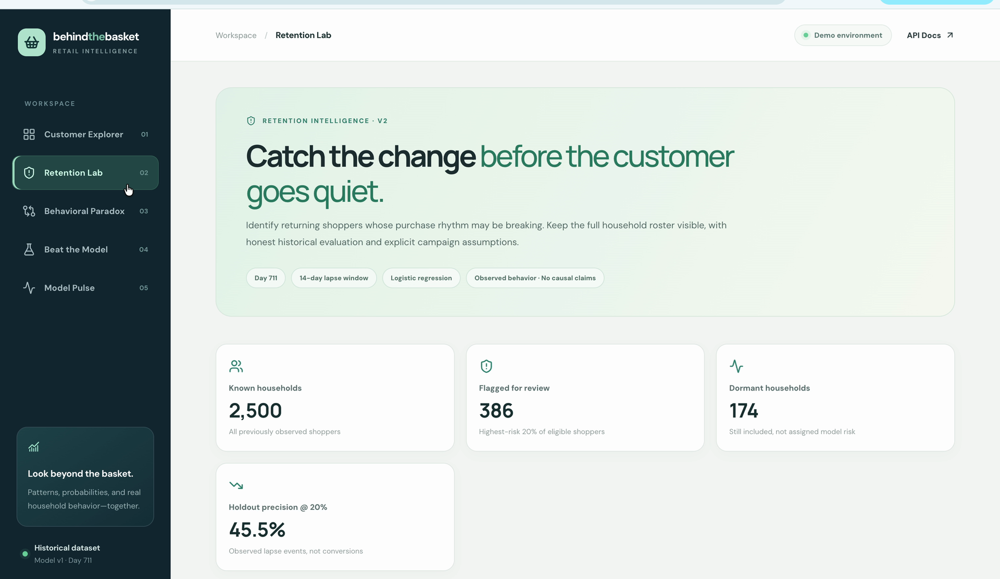
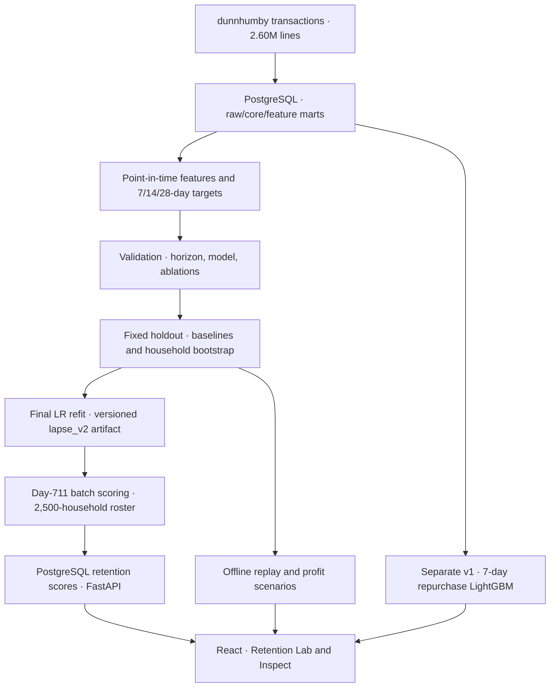
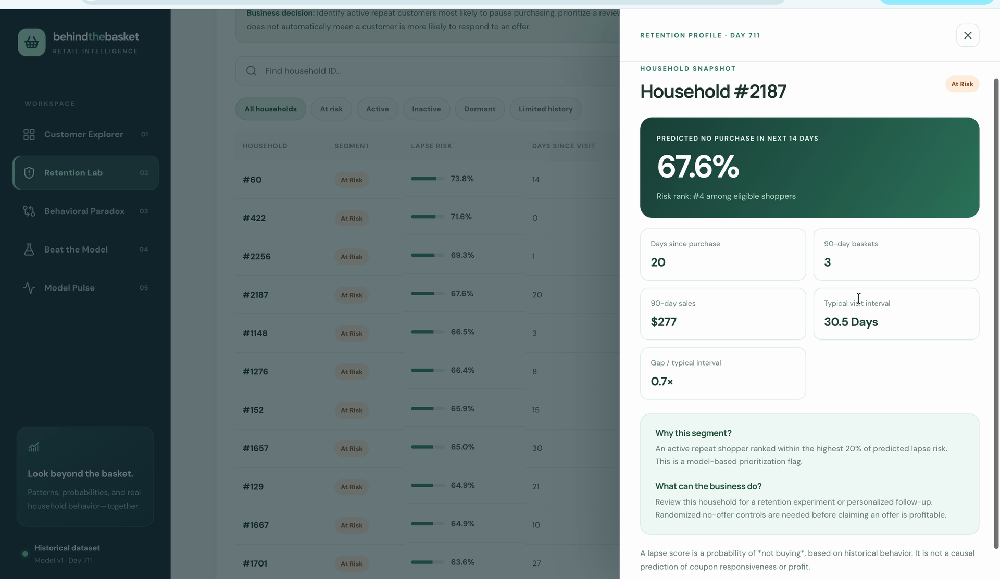
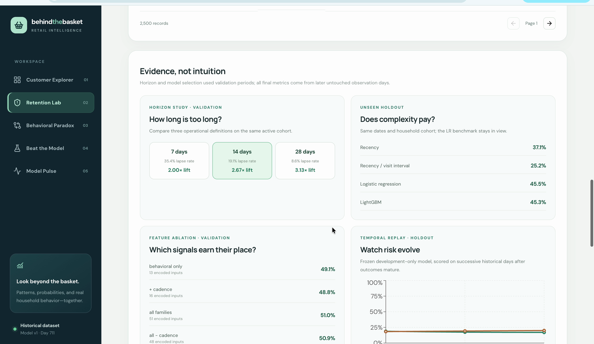
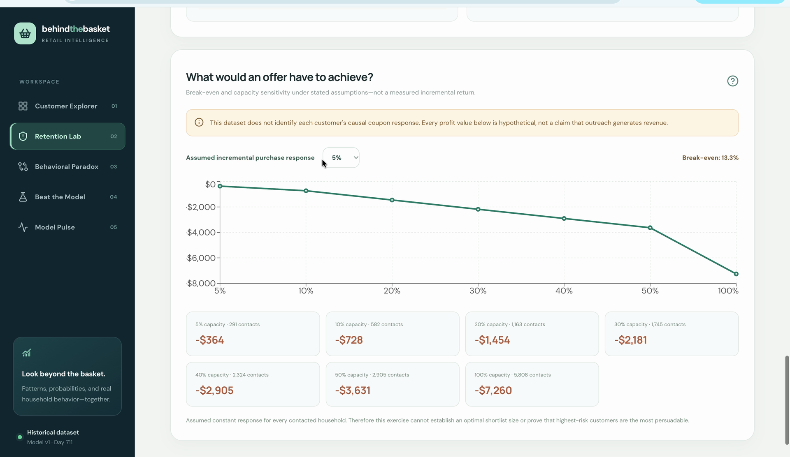
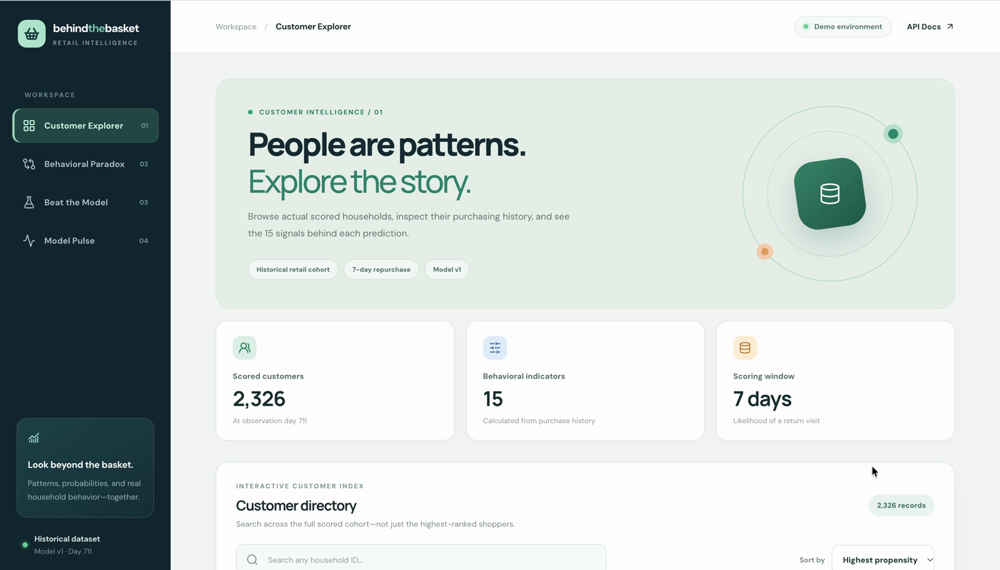
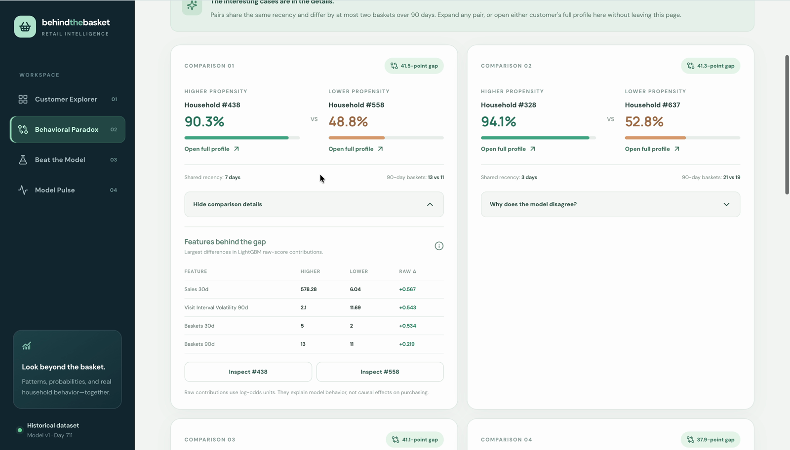

# Behind the Basket — Retail Retention Analytics

**Problem:** Which repeat shoppers are likely to make **no purchase in the next 14 days**?

**Decision:** Rank customers for retention review while keeping **all 2,500 known households** visible—including those too inactive to score reliably.

**Result:** On a chronological holdout, the selected Logistic Regression achieved **45.5% Precision@20%**, **2.38× lift**, and **0.802 ROC-AUC**: **+8.43 percentage points** over a recency baseline (95% household-bootstrap CI **+5.96 to +11.80 pp**). This predicts *lapse*, **not coupon response or incremental revenue**.

[](https://github.com/dorsakh/retail-customer-analytics/actions/workflows/python-tests.yml)
[](https://github.com/dorsakh/retail-customer-analytics/actions/workflows/frontend-tests.yml)

**Python · SQL · PostgreSQL · scikit-learn · LightGBM · FastAPI · React · TypeScript · Recharts · Docker · pytest · Vitest · GitHub Actions**

[**Watch the 55-second application walkthrough**](docs/assets/behind_the_basket_demo.mp4) · [Architecture](#architecture) · [Reproduce locally](#run-and-verify) · [Retention methodology](docs/RETENTION.md) · [Engineering notes](docs/ENGINEERING.md)

[](docs/assets/behind_the_basket_demo.mp4)

*Local application with the original dunnhumby data. Click the screenshot for the 55-second MP4 walkthrough; this is not a publicly hosted web app.*

## Business decision and coverage

The **Retention Lab** presents a risk-ranked shortlist, individual customer inspection, historical model evidence, and explicitly hypothetical campaign economics.

| Day-711 segment | Households | Treatment |
|---|---:|---|
| Active | 1,543 | Scored; below the top-risk cutoff |
| **At risk** | **386** | **Top 20% predicted lapse risk among eligible households** |
| Inactive / dormant | 280 / 174 | Visible; separate lifecycle rules |
| Limited history | 117 | Visible; insufficient evidence to score |
| **Total** | **2,500** | **1,929 model-scored + 571 unscored** |

A high lapse score helps choose **whom to investigate or include in a controlled campaign test**. It does not establish that an offer will change their behavior.

## Historical evaluation

Features are computed *as of each prediction date* from past transactions. The untouched holdout spans **days 600/630/660**, containing **5,808 household-date observations** from **2,163 distinct households**.

| Holdout model | ROC-AUC | Precision@20% | Lift@20% |
|---|---:|---:|---:|
| Recency baseline | 0.676 | 37.1% | 1.94× |
| **Logistic Regression (chosen)** | **0.802** | **45.5%** | **2.38×** |
| LightGBM | 0.804 | 45.3% | 2.37× |

The model identified **529 observed lapse instances** in the shortlist versus **431** for recency at identical capacity (**+98 instances**, not necessarily distinct customers). The LightGBM–LR difference was inconclusive under paired household bootstrap, so a **validation-defined simplicity rule** selected LR.

The **14-day horizon** was also selected on validation only: 7/14/28-day comparisons used Lift@20% among horizons with 10–75% lapse prevalence. The 28-day outcome fell below that prevalence criterion. Six feature families—behavior, purchase cadence, product mix, promotions, demographics, and seasonality—were tested; feature-family ablation used **LightGBM on validation**.

**Offer economics:** With *assumed* CAD $2 cost per contact and CAD $15 margin per incremental purchase, break-even requires **13.3% incremental response** (`2 / 15`). This is a scenario threshold, **not a measured response rate, causal uplift, or realized profit**. Historical replay checks risk, outcomes, and distribution drift on three later dates.

## Architecture



## Product walkthrough

| Household-level decision support | Evidence and model validation |
|---|---|
| [](docs/assets/retention_inspect.png) | [](docs/assets/retention_evidence.png) |
| **Inspect:** risk, recent purchases, typical visit interval, and segment rationale. | **Evidence:** why 14 days and why LR; feature-family ablations and historical replay. |

*Click either image to view the details at full resolution.*

The app also retains **Customer Explorer**, **Behavioral Paradox**, **Beat the Model**, and **Model Pulse** from the independent **v1 seven-day repurchase model**.

<details>
<summary><strong>More screenshots: business scenarios and original v1 explorer</strong></summary>

The campaign panel shows sensitivity to a **hypothetical** incremental response rate. The original v1 views illustrate the separate purchase-propensity workflow.







</details>

## For technical reviewers

| Concern | Implementation and evaluation contract |
|---|---|
| **Data engineering** | 2.60M transaction lines / 276,484 baskets from [dunnhumby *The Complete Journey*](https://www.dunnhumby.com/source-files/); normalized PostgreSQL `raw`, `core`, and analytical marts; source reconciliation checks |
| **Point-in-time safety** | One `(household_key, as_of_day)` per observation; 90-day purchase history, cutoff-bounded coupon/campaign information, 7/14/28-day prospective labels |
| **Cohort policy** | Score repeat shoppers with ≥3 baskets in 90 days and ≤30 days since last visit; retain inactive, dormant, and limited-history households with explicit null risk |
| **Temporal validation** | Train through day 510; validation days 540/570; untouched holdout days 600/630/660; frozen estimator before holdout; later independent final refit |
| **Model governance** | Compare recency/overdue heuristics, Logistic Regression, and LightGBM; fixed 20% shortlist capacity; paired **500-replicate household-cluster bootstrap** |
| **Operational implementation** | Versioned model artifact, PostgreSQL batch scores, FastAPI endpoints, React/TypeScript inspection, offline replay/PSI, Docker Compose, Python/React CI |

<details>
<summary><strong>Open the methodological detail: horizon choice, feature ablations, uncertainty, and limitations</strong></summary>

- **Horizon:** validation lapse prevalence was 35.4% (7d), 19.1% (14d), and 8.6% (28d). The 28-day horizon had higher lift but failed the predeclared ≥10% prevalence gate; the 14-day choice is operationally motivated, **not proven financially optimal**.
- **Model choice:** LightGBM improved validation Precision@20% by only 0.26 pp over LR, below the preset 1.5-pp complexity threshold. On holdout, its slight precision difference was not distinguishable under the paired household bootstrap.
- **Feature ablation:** behavioral-only versus six families (cadence, products, promotions, demographics, seasonality) used **LightGBM on validation**. Some families added little or no benefit. See [retention_ablation.csv](reports/tables/retention_ablation.csv).
- **Replay:** a frozen development model evaluated historical days 600/630/660 with matured outcomes and PSI. This is a retrospective data replay, not production streaming or an independent new-customer cohort.
- **Economics:** a 13.3% break-even threshold follows from *assumed* $2 contact cost ÷ $15 incremental contribution margin. This dataset does **not** identify who would buy *because of* an offer.
- **Reproduction:** source dataset is not bundled. See [RETENTION.md](docs/RETENTION.md) for the SQL/data pipeline, model contract, artifact/version rules, command sequence, evaluation design, and [aggregate outputs](reports/tables).

</details>

## Run and verify

The original [dunnhumby *The Complete Journey*](https://www.dunnhumby.com/source-files/) CSVs and populated database are **not included**. Prepare the real dataset with [SETUP.md](docs/SETUP.md), then apply the v2 SQL and environment configuration in [RETENTION.md](docs/RETENTION.md). **Preserve the existing database volume.**

```bash
python -m pip install -e ".[modeling,serving,dev,reporting]"
python -m retail_analytics.retention run --horizon auto --day 711
docker compose up -d --build api
python -m pytest -q
npm --prefix frontend ci
npm --prefix frontend test
npm --prefix frontend run build
```

Open `http://127.0.0.1:8000/` after database preparation. Aggregate metrics are in [reports/tables](reports/tables); the model contract, splits, ablations, and limitations are in [RETENTION.md](docs/RETENTION.md).

**Scope:** A local, batch-oriented decision-support prototype with CI and retrospective monitoring; **not** a hosted app, real-time campaign engine, controlled uplift experiment, or validated estimate of marketing ROI. The preserved **v1** purchase-propensity results are documented separately in [ENGINEERING.md](docs/ENGINEERING.md).
