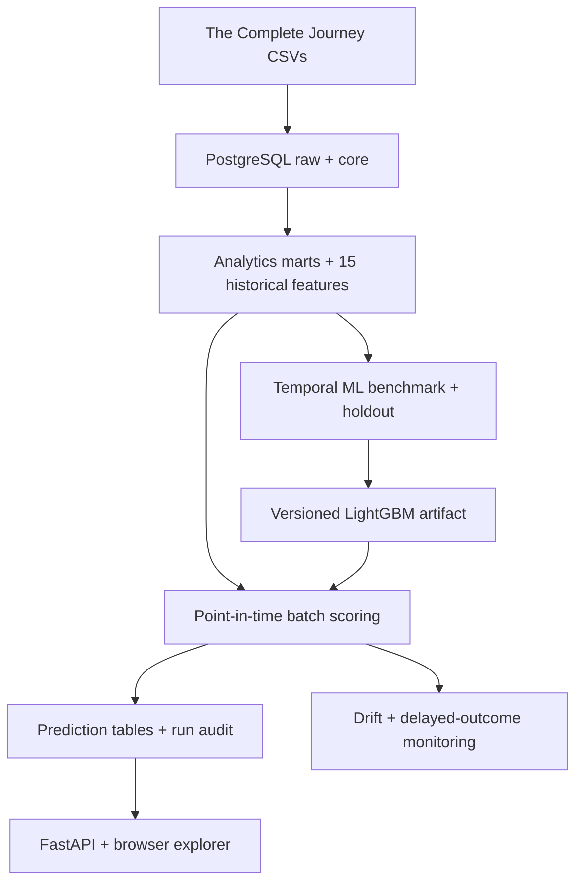

# Retail Customer Analytics

[](https://github.com/dorsakh/retail-customer-analytics/actions/workflows/python-tests.yml)
[](https://github.com/dorsakh/retail-customer-analytics/actions/workflows/frontend-tests.yml)

**End-to-end retail data engineering, customer propensity modeling, and batch inference** — from 2.6M transaction lines in PostgreSQL to a tested LightGBM scoring service, automated monitoring, and an interactive customer explorer.

Built with **PostgreSQL · SQLAlchemy · Python · LightGBM · scikit-learn · FastAPI · React · TypeScript · Vite · Recharts · Docker Compose · pytest · Vitest · GitHub Actions**.

## At a glance

| Data and system | Measured result |
|---|---:|
| Source transactions / baskets / households | 2,595,732 / 276,484 / 2,500 |
| Labeled training/evaluation snapshots | 41,507 across 2,493 households |
| Behavioral features / prediction horizon | 15 / 7 days |
| Chronological holdout | 6,977 observations; days 630, 660, 690 |
| LightGBM holdout ROC-AUC / average precision | **0.809 / 0.858** |
| Precision@top 20% / lift | **94.1% / 1.64×** |
| Improvement over recency + frequency | **+13.9 percentage points** (95% CI: +11.8 to +15.9) |
| Latest completed inference batch | 2,326 households on day 711 |
| Versioned native model artifact | ~0.5 MB |
| Automated tests | **46 Python + 4 React UI** passing locally; CI checks both |

The 20%-capacity model shortlist identified **194 more observed future-purchase instances** than the recency/frequency baseline across three holdout dates, with exactly the same number of selected observations (1,397). This is **better prediction, not evidence of incremental sales** from marketing interventions.


## What was built

| Area | Implementation |
|---|---|
| **Data engineering** | `raw → core → analytics` PostgreSQL layers; key integrity, row-count and financial reconciliation; basket/household marts; parameterized point-in-time feature SQL |
| **ML evaluation** | Five-model benchmark, rolling-origin validation, chronological holdout, probability calibration, feature importance, 1,000-draw household-cluster bootstrap for the original Precision@20% comparison |
| **Inference** | Versioned LightGBM `v1` artifact, feature-contract and SHA-256 validation, 2,326-household batch scoring, ranked probabilities/deciles persisted in PostgreSQL |
| **Automation** | Idempotent upserts, audited success/failure/skip states, per-day PostgreSQL advisory locking, optional 24-hour Docker Compose scheduler |
| **Monitoring** | Feature/prediction PSI, missingness alerts, historical baselines, delayed seven-day outcome checks, persisted reports and API endpoints |
| **API + frontend** | FastAPI/Pydantic, OpenAPI; typed React + TypeScript interface with searchable/paginated customer directory, profile drawer, model challenge, behavioral comparisons, and monitoring |
| **Quality + packaging** | pytest and Vitest/React Testing Library; independent Python and frontend GitHub Actions CI; reproducible multi-stage Docker build; PostgreSQL, API, and opt-in scheduler |

### Architecture



### Behind the Basket — interactive explorer

- **Customer Explorer:** search and paginate **all 2,326** day-711 households; open any profile in a contextual drawer with purchase timeline, all 15 input features, five cohort-relative behavior percentiles, and live model inference.
- **Behavioral Paradox:** compare matched households with similar shopping recency/frequency but divergent model scores; expand native LightGBM contributions and inspect either customer **without leaving the comparison**.
- **Beat the Model:** estimate seven-day repurchase probability on a hidden-outcome historical case; reveal the label, compare Brier losses, and track the session score.
- **Model Pulse:** inspect real PSI/missingness monitoring and audited, idempotent pipeline runs.

The responsive, accessible frontend uses **React 19, TypeScript, Vite, Recharts, Lucide icons**, and the Fetch API. Customer search is **server-side, parameterized, and paginated**; the shared profile drawer maintains page context. The FastAPI service serves the compiled app in production, while Vite proxies API calls during development.

## Evaluation design

| Split | Observation days | Rows |
|---|---|---:|
| Train | 180–540, every 30 days | 29,902 |
| Validation | 570, 600 | 4,628 |
| Final holdout | 630, 660, 690 | 6,977 |

Historical features never use post-observation transactions. The **holdout model** is fitted on train + validation only (34,530 rows); the **production `v1` model** is subsequently fitted on all 41,507 labeled rows. The refitted artifact is **not** used to claim out-of-sample holdout accuracy or power the historical prediction game.

Across capacities of 5%, 10%, 20%, 30%, 40%, and 50% selected per observation day, `business.py` reports precision, purchaser capture, lift, and paired household-bootstrap uncertainty. At 20% capacity, the baseline achieved **80.2%** precision against LightGBM's **94.1%**; the 95% interval for the gain excludes zero.

## Running the project

Requires Python 3.11+, PostgreSQL (tested with 18), `psql`, and the [dunnhumby *The Complete Journey* data](https://www.dunnhumby.com/source-files/). Original transaction files are **not committed**. See [Setup and runbook](docs/SETUP.md) for loading the SQL layers and configuring local or Docker databases.

```bash
# Python dependencies
python -m pip install -e ".[modeling,serving,dev,reporting]"

# Once the PostgreSQL analytics schema and saved v1 model are available
python -m retail_analytics.pipeline --dry-run
python -m retail_analytics.pipeline
python -m retail_analytics.monitor --as-of-day 711

# Independent holdout analysis (re-fits a model through day 600 only)
python -m retail_analytics.business

# Test suite
python -m pytest -q
```

For the local interactive app, populate the explorer tables as described in the runbook, then build the frontend once and launch FastAPI:

```bash
cd frontend
npm ci
npm run build
cd ..
python -m uvicorn retail_analytics.api:app --host 127.0.0.1 --port 8001
```

Open `http://127.0.0.1:8001/` (explorer) or `/docs` (OpenAPI). With an already populated **Docker PostgreSQL database**, the opt-in recurring batch can run via:

```bash
docker compose --profile automation up -d --build
```

Docker Compose provides **local container deployment**, not public cloud hosting. The GitHub Actions workflow implements **CI (tests)**, not automated deployment/CD. Source-data ingestion and materialized-view refresh remain separate upstream operations.

## Repository map

```text
sql/{schema,load,marts,checks,analysis}/   PostgreSQL ELT + integrity checks
src/retail_analytics/
  data.py, models.py, benchmark.py         Modeling datasets and selection
  evaluate.py, uncertainty.py, business.py Holdout, bootstrap, capacity analysis
  train_final.py, score.py, pipeline.py    Model artifact and repeatable inference
  monitor.py, scheduler.py                PSI, delayed outcomes, automation
  api.py, explorer.py, build_explorer.py   REST API and interactive case data
  web/index.html                          Legacy no-build fallback
frontend/src/{pages,components}/         React + TypeScript frontend
frontend/package-lock.json               Reproducible npm dependencies
tests/                                    pytest
artifacts/models/v1/                     ~0.5 MB model + version metadata
reports/{tables,figures}/                Derived evaluation outputs
docs/                                     Reproduction + engineering notes
Dockerfile, compose.yaml                 Containerized services
.github/workflows/{python-tests,frontend-tests}.yml  CI
```

## Engineering details

- [Technical notes](docs/ENGINEERING.md) — all feature groups, benchmark design, capacity curves, artifact integrity, batch locking, monitoring thresholds, and limitations.
- [Setup and runbook](docs/SETUP.md) — input data, database build order, model training, serving, Docker, and demo initialization.

**Scope:** This dataset follows a fixed historical cohort of frequent-shopping households. The model predicts seven-day return propensity, **not** the causal benefit of a coupon or marketing contact. The current scheduler does not ingest new transactions.
