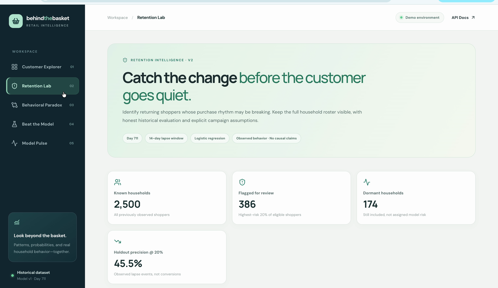
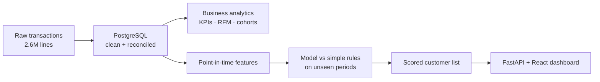
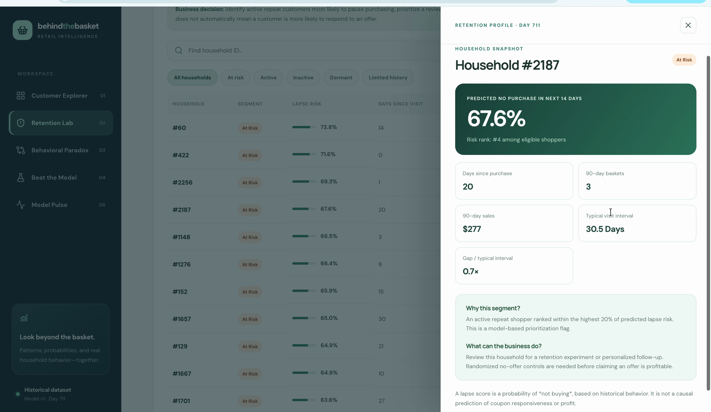
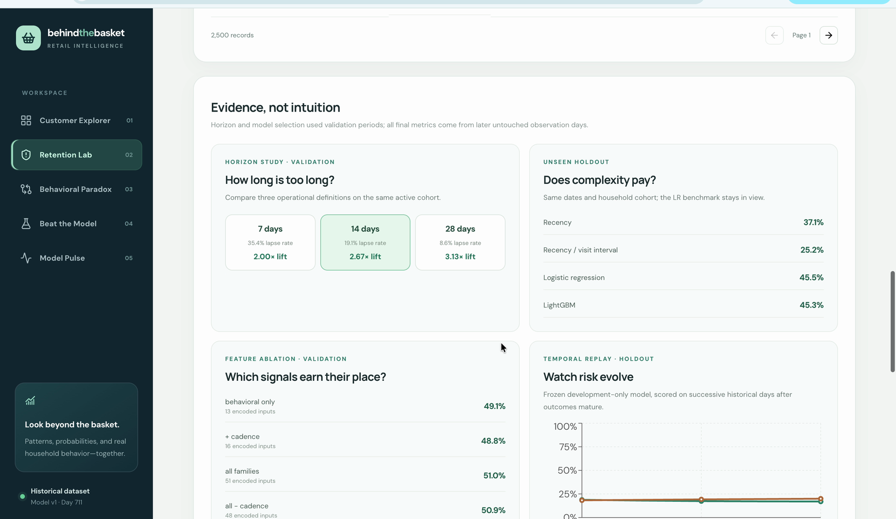
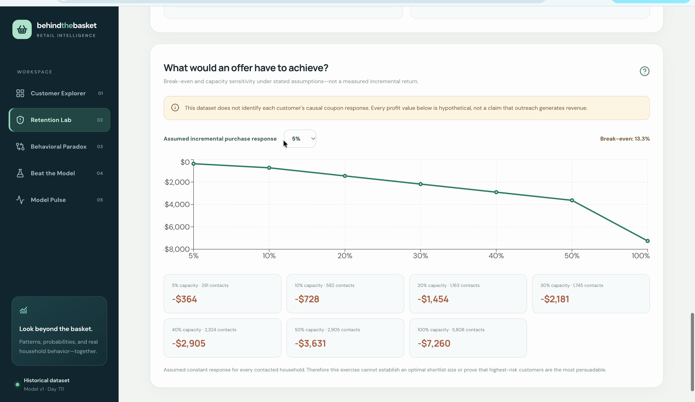
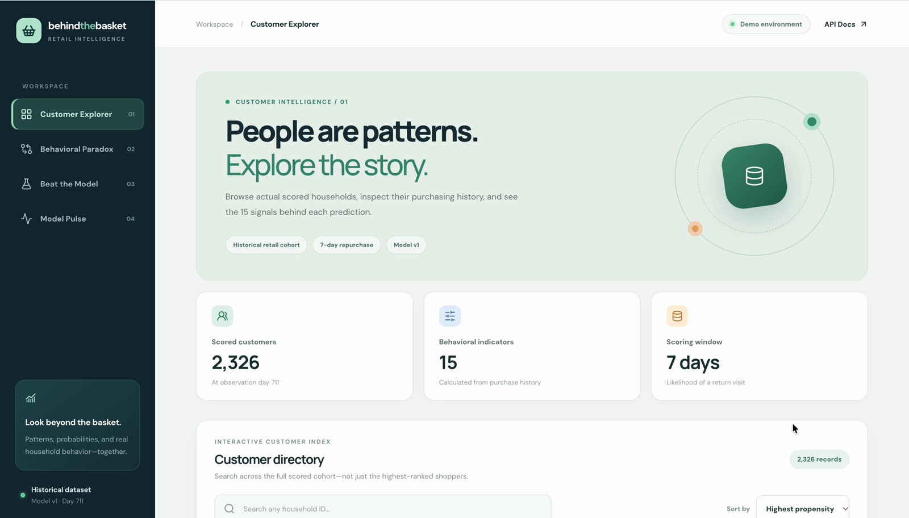
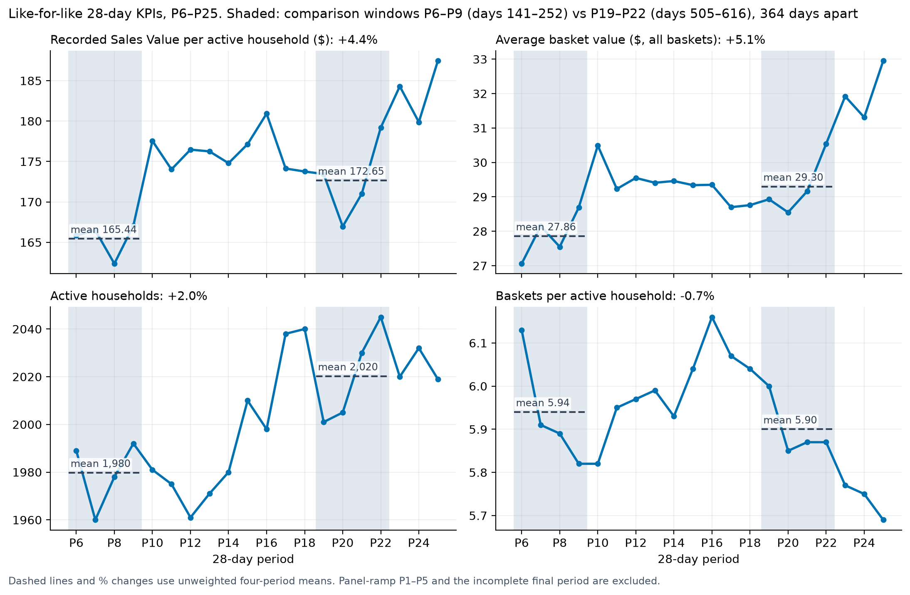
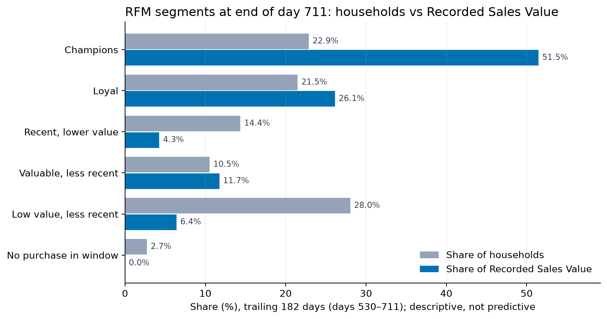
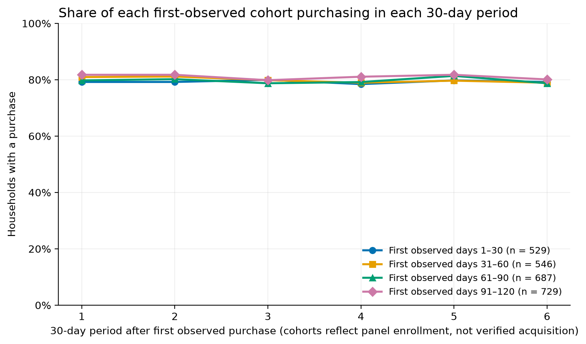

# Behind the Basket: Spotting Shoppers Before They Drift Away

Using **2.6 million real grocery transactions** from **2,500 households**, I built an end-to-end system that flags which regular shoppers are about to stop buying, so a retention team knows whom to look at first.

[](https://github.com/dorsakh/retail-customer-analytics/actions/workflows/python-tests.yml)
[](https://github.com/dorsakh/retail-customer-analytics/actions/workflows/frontend-tests.yml)

**SQL · PostgreSQL · Python · scikit-learn · LightGBM · FastAPI · React · TypeScript · Docker · GitHub Actions**

[**▶ Watch the 55-second walkthrough**](docs/assets/behind_the_basket_demo.mp4)

## Key findings

- **The model finds at-risk shoppers 2.4× better than chance.** Of the 20% of shoppers it flags, **45%** actually make no purchase in the next two weeks, compared with **19%** of shoppers overall and **37%** when ranking by "days since last visit."
- **A simple rule comes close, and I report it.** Ranking by purchase frequency alone reaches **44%**. The model's edge over it is small and not statistically clear; the model adds calibrated probabilities and a consistent scoring pipeline.
- **Most lapses are temporary.** **77%** of shoppers who skipped two weeks came back within the following month. The opportunity is reaching people at the right time, not rescuing lost customers.
- **Sales are concentrated.** The top **23%** of households (RFM "Champions") generate **51%** of sales, so a retention team has a clear place to start.
- **Growth came from bigger baskets, not more trips.** Comparing the same weeks one year apart, sales rose **6.5%**, mostly because the average basket was worth **5.1%** more; shopping trips per household barely changed.

[](docs/assets/behind_the_basket_demo.mp4)

*Screenshot of the locally running app on the real dataset. Click it for the walkthrough video.*

## What I built

| Layer | What it does |
|---|---|
| **Data pipeline** | Loads seven raw CSVs into PostgreSQL (raw → clean → analytics) and reconciles every total back to the source |
| **Business analytics** | SQL for 28-day KPIs, RFM segmentation, and cohort activity |
| **Prediction** | Features built only from past data at each date; model compared with simple rules on later, unseen periods |
| **Scoring** | Scores all 2,500 households; 386 flagged at risk, and inactive or new shoppers kept visible with their own label |
| **App** | FastAPI backend and React dashboard to browse the at-risk list and inspect any household |
| **Quality** | Python and frontend tests, SQL tests against PostgreSQL in CI, Docker setup |



## How I made sure the results hold up

- **No peeking at the future.** Every feature uses only purchases available on the prediction date. The model was chosen on one period and tested once on a later period it never saw.
- **Tested against simple rules, not just against nothing.** I compared the model with four rule-based rankings and reported where a simple rule came close.
- **Uncertainty is measured.** Confidence intervals resample whole households, because the same household appears on several dates.
- **The simpler model was chosen on purpose.** LightGBM was not meaningfully better than Logistic Regression, so a rule set in advance picked the simpler, more transparent model.
- **Numbers reconcile.** SQL checks confirm that baskets, households, and sales match the raw line items.

## Limitations

- The model predicts **short-term disengagement** (no purchase in 14 days), not permanent churn.
- It predicts who is likely to lapse, **not who would respond to an offer**. Measuring that would need a randomized campaign test.
- The data is a historical panel of known households, so results do not cover brand-new customers.
- The campaign profit view uses **assumed** costs and response rates; it is a scenario tool, not measured ROI.
- This is a local prototype, not a hosted service.

## Explore further

| If you want to see… | Go to |
|---|---|
| Full evaluation: baselines, confidence intervals, horizon and model choice, feature tests | [docs/RETENTION.md](docs/RETENTION.md) |
| KPI, RFM, and cohort analysis with definitions and figures | [Descriptive business analytics](#descriptive-business-analytics) |
| Data platform, batch scoring, monitoring, API, and the earlier v1 model | [docs/ENGINEERING.md](docs/ENGINEERING.md) |
| How to set up the database and run everything | [docs/SETUP.md](docs/SETUP.md) |
| SQL | [sql/](sql) |
| Result tables and figures | [reports/](reports) |

<details>
<summary><strong>More screenshots</strong></summary>

| Inspect a household | Model evidence |
|---|---|
| [](docs/assets/retention_inspect.png) | [](docs/assets/retention_evidence.png) |



The app also includes views from an earlier 7-day repurchase model (v1), documented in [ENGINEERING.md](docs/ENGINEERING.md).



</details>

## Descriptive business analytics

<details>
<summary><strong>KPI, RFM, and cohort analysis: findings, figures, definitions, and validation</strong></summary>

PostgreSQL SQL over the `analytics.baskets` mart reports business KPIs, first-observed cohort activity, and RFM value segmentation. These are descriptive results, separate from the predictive lifecycle segments in [RETENTION.md](docs/RETENTION.md). They describe observed differences, not established causes.

### Findings

The like-for-like comparison uses periods **6–9 (days 141–252)** and **19–22 (days 505–616)**. Those windows are 364 days (13 × 28) apart, or 52 weeks, so they are approximately season-aligned. Each window value is the unweighted mean of four period-level KPIs ([kpi_like_for_like.csv](reports/tables/kpi_like_for_like.csv)).

1. **Higher average basket value accounts for most of the observed difference, more than reach or frequency.** Recorded Sales Value per period was **6.5%** higher in the later window ($327,528 → $348,852). Active households (households with at least one basket) were **2.0%** higher (1,980 → 2,020), and Recorded Sales Value per active household was **4.4%** higher ($165.44 → $172.65). Baskets per active household were **0.7%** lower (5.94 → 5.90). Average basket value (Recorded Sales Value ÷ all baskets) was **5.1%** higher ($27.86 → $29.30). The data does not show whether the higher basket value reflects prices, product mix, or something else.
2. **Recorded Sales Value is concentrated in the top RFM segments.** In the trailing 182 days to the end of day 711, *Champions* are **22.9%** of households and **51.5%** of Recorded Sales Value. Together with *Loyal*, **44.4%** of households account for **77.6%**. The largest segment, *Low value, less recent* (**28.0%** of households), contributes **6.4%**. Some concentration is built in, because monetary value is one of the inputs that defines the segments.
3. **Cohort activity is flat rather than decaying.** Across the four first-observed cohorts and their first six **30-day** periods, **78.5–81.8%** of households purchased in each period. 2,491 of 2,500 households first appear in days 1–120. That pattern is consistent with panel enrollment of existing shoppers, so these cohorts cannot show retention decay after acquisition.
4. **Fuel's share varies by period.** Across like-for-like periods, fuel ranged from **6.8% to 10.7%** of Recorded Sales Value. Between the two comparison windows its mean share moved only **−0.3 pp** (8.7% → 8.4%). Period-to-period changes in total Recorded Sales Value include this fuel variation.







### Definitions

- **Recorded Sales Value** is `SUM(sales_value)`, which the source documents as the amount the retailer receives. Manufacturer coupons may be reimbursed, so it is not necessarily what customers paid. It is also not net revenue or profit: the data records no returns, refunds, cancellations, tax, or cost. It **includes fuel**, which accounts for **7.87%** of the $8.06M total; fuel quantities make item-unit metrics meaningless, so none are reported.
- **Periods.** KPIs use **28-day periods** (four whole weeks; the data has day numbers, not calendar dates). Periods 1–5 (days 1–140), when ≥1% of households were first observed, are flagged as **panel ramp**. Period 26 (11 days) is flagged **incomplete**. Both stay in [period_kpis.csv](reports/tables/period_kpis.csv) but are excluded from like-for-like comparisons.
- **Average basket value** = Recorded Sales Value ÷ all baskets, including the 942 zero-value baskets (0.34%).
- **RFM:** recency uses complete history; frequency and Recorded Sales Value use days 530–711. Each is scored 1–5 by quintile among the 2,432 households with a purchase in that window, and ties share a score. The 68 households with no purchase in the window form their own segment.
- **Cohorts** use 30-day periods relative to each household's first observed purchase, which reflects panel enrollment, not verified customer acquisition.
- **Discount fields** (loyalty, coupon match, manufacturer coupon) are reported as separate recorded amounts. No customer-discount rate is derived, because the source does not define one.

### Validation and reproduction

- **SQL:** [period_kpis.sql](sql/analysis/period_kpis.sql), [cohort_retention.sql](sql/analysis/cohort_retention.sql), [rfm_segments.sql](sql/analysis/rfm_segments.sql).
- **Reconciliation:** [kpi_reconciliation.sql](sql/checks/kpi_reconciliation.sql) reconciles the basket mart with core line items: sales, baskets, households, 28-day period sales, and RFM-window sales. It also confirms there are no negative sales lines and no multi-day baskets. SQL fixture tests run against a PostgreSQL service in CI; live-data reconciliation tests run locally.
- **Reproduce:** `python -m retail_analytics.descriptive` (requires the `reporting` extra and the populated database; see [SETUP.md](docs/SETUP.md)).

</details>

## Run locally

The [dunnhumby *The Complete Journey*](https://www.dunnhumby.com/source-files/) data is not included. Load it first by following [SETUP.md](docs/SETUP.md) and [RETENTION.md](docs/RETENTION.md).

```bash
python -m pip install -e ".[modeling,serving,dev,reporting]"
python -m retail_analytics.retention run --horizon auto --day 711
python -m retail_analytics.descriptive
docker compose up -d --build api      # then open http://127.0.0.1:8000/
python -m pytest -q
npm --prefix frontend ci && npm --prefix frontend test
```
